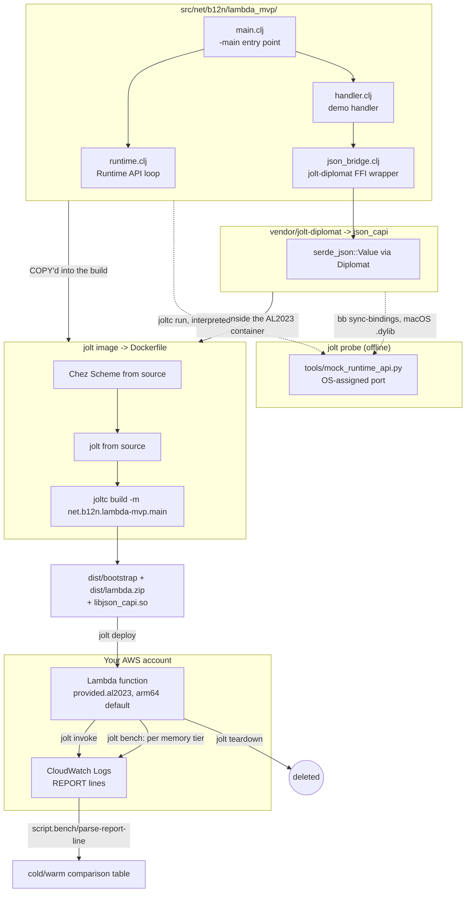

# Architecture

This page is the whole-system view: how the runtime loop, the Rust JSON builder, the Docker build, and the two babashka-driven tools (AWS lifecycle, bench) fit together. Each piece has its own page, linked below.

## The whole flow

## The Runtime API loop

`src/net/b12n/lambda_mvp/{runtime,handler,main}.clj` is the whole custom runtime: a poll/execute/respond loop against the Lambda Runtime API, a demo handler, and the `-main` entry point `joltc build` compiles. It's generic: `runtime/run` takes any `(fn [event-json ctx]) -> json-string`, so to use your own handler, write one new namespace and point `main.clj` at it.

See [The Runtime API loop](runtime-api-loop.md) for the full contract, the design notes behind `:throw-exceptions false`, and how `tools/mock_runtime_api.py` gives `jolt probe` a two-second local iteration on runtime-loop changes.

## The Rust JSON builder

Unlike `lambda-mvp-jlt`'s, `handler.clj` doesn't hand-interpolate a JSON string. It calls `json_bridge.clj`, which loads a small Rust crate (`json_capi`, vendored from jolt-diplomat's `examples/json`) that wraps `serde_json::Value` behind Diplomat-generated FFI bindings. The same crate is built two ways: `bb sync-bindings` produces a macOS `.dylib` for local dev (`jolt probe`, a REPL), and the `Dockerfile`'s build stage runs the same `bind.clj` inside the AL2023 container to produce the Linux `.so` that ships in `lambda.zip`.

See [The Rust JSON builder via jolt-diplomat](json-builder.md) for why this exists, what jolt-diplomat generates, and the vendoring workflow.

## The build

`jolt image` runs a multi-stage Docker build that compiles Chez Scheme and jolt from source on Amazon Linux 2023, the same OS Lambda's `provided.al2023` execution environment runs, because AL2023's glibc (2.34) is older than what jolt's prebuilt Linux binary needs (2.35 or newer). The same build stage also runs `bind.clj` against the vendored jolt-diplomat crate, so the output is a self-contained `bootstrap` executable plus a `lib/` directory of every non-glibc shared library it links or dlopens, now including `libjson_capi.so`/`libjson_capi_shim.so`.

See [Building on Amazon Linux 2023](al2023-build.md) for the glibc constraint in full, the recipe's five steps, and the packaging gotchas (`which`, `xxd`) that cost a build round each in the original research project.

## The AWS lifecycle tool

`script/aws_lifecycle.clj` is a small, generic (no hardcoded profile, account, or region) idempotent create-or-update-or-delete tool, driven entirely by the caller's own `aws` CLI configuration. `deploy!` creates the IAM role and Lambda function on first run and updates them on every later run; `invoke!` runs a single ad-hoc invocation; `teardown!` deletes both. `jolt deploy`/`jolt invoke`/`jolt teardown` are thin wrappers around it.

`deploy!` never reads `LAMBDA_ARCH` itself. It reads the architecture out of the ELF header of the `dist/bootstrap` `jolt image` last built and passes `--architectures` on both create and update, so a deploy always matches the binary on disk and can flip an existing function's architecture on a later run.

Every mutating AWS call checks its own exit code and fails loudly with the AWS CLI's own error text. That came from live testing during this project's development: an early version reported a successful teardown even when a delete call had failed.

## `jolt demo`: the same flow, one command

`jolt demo` (`script/demo.clj`) runs `image`, `deploy` and `invoke` in order, after checking tools on PATH, AWS credentials and region, Docker daemon access, and that Docker can actually run containers for the target `LAMBDA_ARCH`. It sequences the same pieces, with every failure mode checked up front instead of surfacing mid-build.

## The bench tool

`script/bench.clj` holds the pure logic: `parse-report-line` turns a CloudWatch `REPORT` line into a Clojure map, and `format-table` renders a comparison across memory tiers as markdown. Neither function does any I/O, so `jolt test` can unit-test them with no AWS account.

`script/bench_run.clj` is the orchestration: for each memory tier, it changes the function's configured memory (which forces a fresh execution environment on the next invoke), measures one cold sample and several warm ones, and calls `format-table` on the results. It also checks the AWS response's `FunctionError` field before trusting anything else in it, since `aws lambda invoke` returns a successful exit code even when the function itself crashes.

See [Cold vs. warm boot](cold-warm-boot.md) for what the table means and how to reproduce a jolt-version comparison on your own account.

## Why `load-file`, not `:require`, between the two bench files

`script/bench_run.clj` loads `script/bench.clj` via `(load-file "script/bench.clj")` rather than a normal `:require`. A `script/`-relative namespace doesn't resolve reliably across every way this project's babashka tasks invoke a script (a `bb.edn` task's own classpath, and a direct `bb script/foo.clj` run). `load-file` as its own top-level form, followed by fully-qualified calls, is the pattern verified to work in both. The same constraint is why `script/aws_lifecycle.clj` and `script/bench_run.clj` each carry their own small `sh`/`die!` helper: a shared helper file would need the same `load-file` chain to reach either of them.

## See also

- [Contributing](contributing.md): build, test, and PR conventions.
- [Project README](https://github.com/b12n-oss/lambda-mvp-rst/blob/main/README.md): the same quickstart in prose.
